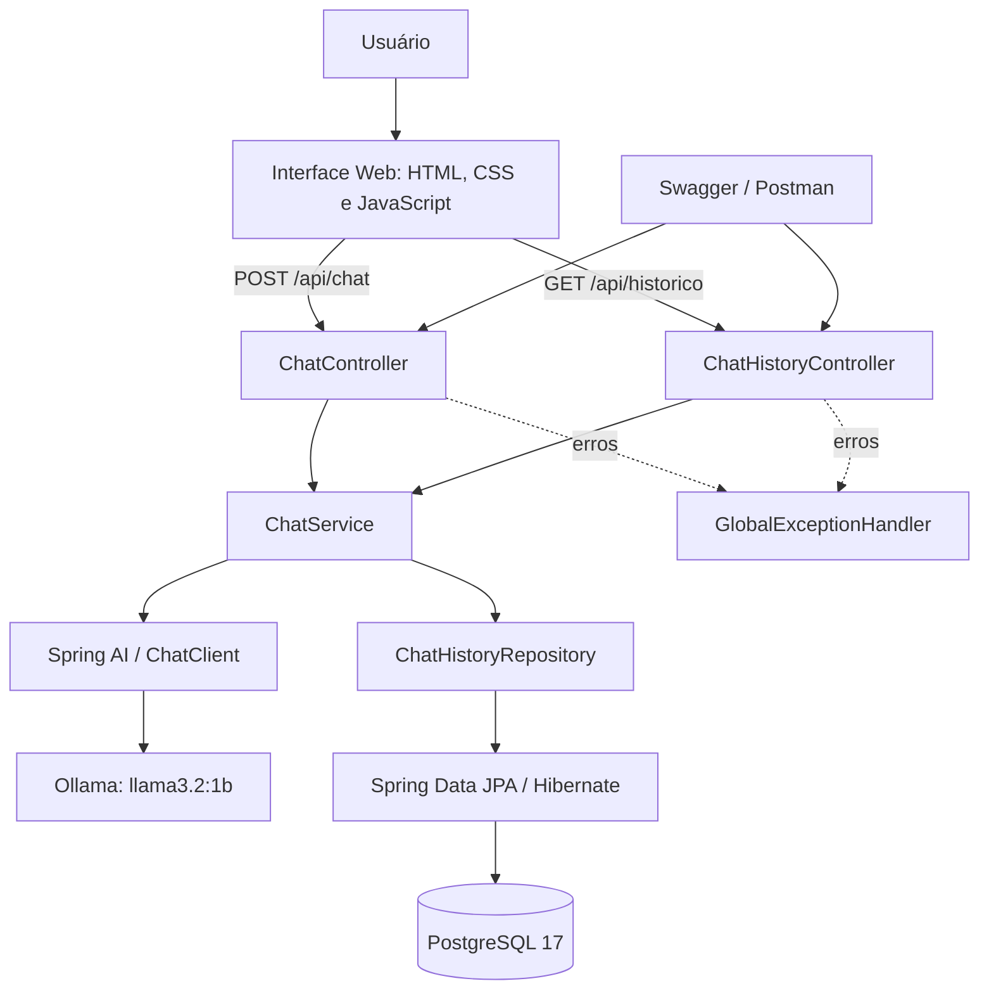

<h1 align="center">☕ JavaMentor AI - CP6 Java Advanced</h1>

<p align="center">
  <strong>Assistente inteligente de estudos em Java, desenvolvido com Spring Boot, Spring AI e Ollama.</strong>
</p>

<p align="center">
  
  
  
  
</p>

O **JavaMentor AI** é uma aplicação web e API REST desenvolvida para o **Checkpoint 6 (CP6)** da disciplina de **Java Advanced**, da **FIAP**. Seu objetivo é auxiliar no aprendizado de Java e de seu ecossistema por meio de um assistente de inteligência artificial executado localmente com **Ollama**.

A aplicação utiliza **Spring AI** para comunicação com o modelo **`llama3.2:1b`**, **Spring Data JPA** e **PostgreSQL** para persistir as perguntas e respostas, além de uma interface web própria para interação com o assistente.

---

## 📑 Índice

- [👤 Integrante](#-integrante)
- [📚 Sobre o Projeto](#-sobre-o-projeto)
- [🏗️ Arquitetura](#️-arquitetura)
- [🧭 Diagrama de Arquitetura](#-diagrama-de-arquitetura)
- [📁 Estrutura do Projeto](#-estrutura-do-projeto)
- [🚀 Tecnologias Utilizadas](#-tecnologias-utilizadas)
- [📦 Entidade e Persistência](#-entidade-e-persistência)
- [🧠 Integração com Spring AI e Ollama](#-integração-com-spring-ai-e-ollama)
- [📡 Endpoints](#-endpoints)
- [📄 HTTP Status Codes](#-http-status-codes)
- [📘 Swagger / OpenAPI](#-swagger--openapi)
- [💻 Interface Web](#-interface-web)
- [🗄️ Banco de Dados](#️-banco-de-dados)
- [⚙️ Como Executar](#️-como-executar)
- [🧪 Testes Automatizados](#-testes-automatizados)
- [📬 Postman](#-postman)
- [🐳 Docker](#-docker)
- [📌 Funcionalidades Implementadas](#-funcionalidades-implementadas)
- [🎥 Demonstração e Entrega](#-demonstração-e-entrega)

---

## 👤 Integrante

<table>
  <tr>
    <td width="130">
      
    </td>
    <td>
      <b>Moisés Barsoti Andrade de Oliveira</b><br/>
      <b>RM:</b> 565049 &nbsp;&nbsp;|&nbsp;&nbsp; <b>Turma:</b> 2TDSPO — FIAP<br/>
      <b>GitHub:</b> <a href="https://github.com/moisesBarsoti">moisesBarsoti</a>
    </td>
  </tr>
</table>

---

## 📚 Sobre o Projeto

O JavaMentor AI é um assistente virtual voltado ao apoio aos estudos de **Java**, **programação orientada a objetos**, **Spring Boot**, **APIs REST** e tecnologias relacionadas.

As principais responsabilidades da aplicação são:

- Receber perguntas do usuário por uma API REST ou pela interface web;
- Encaminhar mensagens a um modelo de IA local utilizando Spring AI;
- Utilizar um *system prompt* personalizado para orientar as respostas;
- Retornar as respostas produzidas pela IA, juntamente com informações do modelo;
- Persistir as interações no PostgreSQL;
- Consultar o histórico de perguntas e respostas por data decrescente;
- Validar o conteúdo recebido e tratar falhas da integração com a IA;
- Permitir testes pelo Swagger UI, Postman e testes automatizados.

O sistema **não utiliza uma API paga de IA**: a geração das respostas é realizada por um modelo instalado localmente com Ollama.

---

## 🏗️ Arquitetura

A aplicação segue uma **arquitetura em camadas**, separando o transporte HTTP, as regras de aplicação, os contratos de dados e a persistência.

### Responsabilidades das camadas

```txt
Controller
→ ChatController: recebe perguntas em POST /api/chat
→ ChatHistoryController: consulta o histórico em GET /api/historico

DTO
→ request/ChatRequest: valida a mensagem recebida
→ response/ChatResponse: representa a resposta da IA
→ response/ChatHistoryResponse: representa um registro do histórico

Service
→ ChatService: executa o prompt, chama o Ollama e consulta/salva o histórico

Repository
→ ChatHistoryRepository: realiza operações JPA sobre o histórico

Entity
→ ChatHistory: mapeia a tabela chat_history

Exception
→ DomainException: representa erros de regra de negócio
→ AiProviderException: representa falhas do provedor de IA
→ GlobalExceptionHandler: converte exceções em respostas HTTP

Resources
→ static/: HTML, CSS e JavaScript da interface web
→ application.properties: configuração da aplicação
```

A implementação utiliza **injeção de dependências**, **Service Layer**, **Repository Pattern** por meio do Spring Data JPA, **DTOs** e **tratamento centralizado de exceções**.

---

## 🧭 Diagrama de Arquitetura



### Fluxo de uma pergunta

1. O usuário informa uma mensagem pela interface ou por um cliente HTTP.
2. O `ChatController` recebe o JSON e valida o `ChatRequest`.
3. O `ChatService` combina a mensagem com o prompt de sistema e chama o `ChatClient`.
4. O Spring AI envia a solicitação ao modelo `llama3.2:1b` no Ollama local.
5. O conteúdo retornado é armazenado na tabela `chat_history`.
6. O cliente recebe o `ChatResponse` com a resposta, identificador, provedor, modelo e data/hora.
7. O histórico pode ser consultado sem realizar novas chamadas ao modelo de IA.

---

## 📁 Estrutura do Projeto

```txt
JavaMentorAI/
├── .mvn/
├── database/
│   └── schema.sql
├── postman/
│   └── JavaMentor AI - CP6.postman_collection.json
├── src/
│   ├── main/
│   │   ├── java/br/com/fiap/javamentorai/
│   │   │   ├── controller/
│   │   │   │   ├── ChatController.java
│   │   │   │   └── ChatHistoryController.java
│   │   │   ├── dto/
│   │   │   │   ├── request/ChatRequest.java
│   │   │   │   └── response/
│   │   │   │       ├── ChatResponse.java
│   │   │   │       └── ChatHistoryResponse.java
│   │   │   ├── entity/ChatHistory.java
│   │   │   ├── exception/
│   │   │   │   ├── DomainException.java
│   │   │   │   ├── AiProviderException.java
│   │   │   │   └── GlobalExceptionHandler.java
│   │   │   ├── repository/ChatHistoryRepository.java
│   │   │   ├── service/ChatService.java
│   │   │   └── JavaMentorAiApplication.java
│   │   └── resources/
│   │       ├── static/
│   │       │   ├── index.html
│   │       │   ├── style.css
│   │       │   └── script.js
│   │       └── application.properties
│   └── test/java/br/com/fiap/javamentorai/
│       ├── controller/ChatControllerTest.java
│       └── JavaMentorAiApplicationTests.java
├── .gitignore
├── mvnw
├── mvnw.cmd
├── pom.xml
└── README.md
```

A estrutura representa os arquivos e pacotes desenvolvidos durante o CP6. A pasta `target/` é gerada pelo Maven e não precisa ser enviada ao Git.

---

## 🚀 Tecnologias Utilizadas

| Tecnologia | Uso no projeto |
| --- | --- |
| **Java 21** | Linguagem principal |
| **Spring Boot 4.1.2** | Aplicação e API REST |
| **Spring Web MVC** | Controllers e processamento HTTP |
| **Spring AI 2.0.1** | Integração da aplicação com o modelo de IA |
| **Ollama** | Execução local do modelo de linguagem |
| **`llama3.2:1b`** | Modelo de IA utilizado |
| **Spring Data JPA / Hibernate** | Persistência relacional |
| **PostgreSQL 17** | Banco de dados do histórico |
| **Docker Desktop** | Execução local do PostgreSQL |
| **Jakarta Bean Validation** | Validação do DTO de entrada |
| **Lombok** | Redução de código repetitivo na entidade |
| **Springdoc OpenAPI 3.2.0** | Swagger UI e documentação OpenAPI |
| **HTML5, CSS3 e JavaScript** | Interface web responsiva |
| **JUnit 5, Mockito e MockMvc** | Testes automatizados do Controller |
| **Postman** | Testes manuais da API |
| **Maven Wrapper** | Compilação e execução do projeto |
| **IntelliJ IDEA** | Desenvolvimento |

---

## 📦 Entidade e Persistência

### `ChatHistory`

Representa uma interação com o assistente, armazenada na tabela `chat_history`.

| Atributo Java | Coluna PostgreSQL | Tipo | Finalidade |
| --- | --- | --- | --- |
| `id` | `id` | `BIGINT` | Identificador gerado automaticamente |
| `question` | `question` | `VARCHAR(2000)` | Pergunta enviada |
| `answer` | `answer` | `TEXT` | Resposta do modelo |
| `provider` | `provider` | `VARCHAR(50)` | Provedor de IA (`Ollama`) |
| `model` | `model` | `VARCHAR(100)` | Identificação do modelo |
| `createdAt` | `created_at` | `TIMESTAMP(6)` | Data/hora da criação |

O identificador utiliza `GenerationType.IDENTITY` e a data de criação é preenchida por um método anotado com `@PrePersist`.

### Acesso aos dados

O `ChatHistoryRepository` estende `JpaRepository<ChatHistory, Long>` e disponibiliza o método:

```java
List<ChatHistory> findAllByOrderByCreatedAtDesc();
```

Esse método permite recuperar as interações **da mais recente para a mais antiga**.

---

## 🧠 Integração com Spring AI e Ollama

O `ChatService` utiliza o `ChatClient` do Spring AI para gerar respostas:

```java
String answer = chatClient.prompt()
        .system(SYSTEM_PROMPT)
        .user(question)
        .call()
        .content();
```

### Prompt de sistema

O prompt personalizado orienta o JavaMentor AI a:

- Responder em **português brasileiro**;
- Explicar conceitos de Java de forma didática;
- Apoiar o estudo de orientação a objetos, Spring Boot e APIs REST;
- Incluir exemplos quando apropriado;
- Priorizar respostas claras e objetivas;
- Informar quando a pergunta estiver fora de sua especialidade;
- Evitar inventar informações quando não souber responder.

**Observação:** prompts orientam modelos probabilísticos, mas não garantem bloqueio rígido de temas fora do domínio nem exatidão em todas as respostas.

### Configuração da integração

```properties
spring.ai.model.chat=ollama
spring.ai.ollama.base-url=http://localhost:11434
spring.ai.ollama.chat.model=llama3.2:1b
spring.ai.retry.max-attempts=1
```

O Ollama deve estar iniciado e o modelo precisa estar disponível localmente para que o chat produza respostas.

---

## 📡 Endpoints

| Método | Endpoint | Descrição | Sucesso |
| --- | --- | --- | --- |
| `POST` | `/api/chat` | Envia uma pergunta à IA e salva a interação no histórico | `200 OK` |
| `GET` | `/api/historico` | Recupera o histórico ordenado por data decrescente | `200 OK` |

### POST `/api/chat`

Recebe uma pergunta, executa a chamada ao Ollama pelo Spring AI e salva a resposta no PostgreSQL.

**Request**

```http
POST http://localhost:8080/api/chat
Content-Type: application/json
```

```json
{
  "mensagem": "Explique o conceito de herança em Java."
}
```

**Response — exemplo de formato (`200 OK`)**

```json
{
  "id": 4,
  "resposta": "Herança permite criar classes derivadas que reutilizam e especializam comportamentos de outras classes.",
  "provedor": "Ollama",
  "modelo": "llama3.2:1b",
  "dataHora": "2026-11-01T12:15:00"
}
```

> O texto da resposta, o ID e a data/hora são ilustrativos e variam conforme a execução.

**Validações do campo `mensagem`:** obrigatório, não pode estar em branco e aceita no máximo **2.000 caracteres**.

### GET `/api/historico`

Retorna todas as perguntas e respostas armazenadas no PostgreSQL, da mais recente para a mais antiga.

**Request**

```http
GET http://localhost:8080/api/historico
```

**Response — exemplo de formato (`200 OK`)**

```json
[
  {
    "id": 4,
    "pergunta": "Explique o conceito de herança em Java.",
    "resposta": "Herança permite criar classes derivadas que reutilizam comportamentos.",
    "provedor": "Ollama",
    "modelo": "llama3.2:1b",
    "dataHora": "2026-11-01T12:15:00"
  }
]
```

Caso não existam registros, o endpoint retorna uma lista vazia (`[]`) com status `200 OK`.

---

## 📄 HTTP Status Codes

| Código | Descrição | Aplicação |
| --- | --- | --- |
| **200 OK** | Requisição realizada | Envio de pergunta e consulta ao histórico |
| **400 Bad Request** | Dados inválidos | Mensagem vazia, acima do limite ou JSON inválido |
| **405 Method Not Allowed** | Método HTTP não permitido | Ex.: usar GET em `/api/chat` |
| **503 Service Unavailable** | Provedor de IA indisponível | Falha de comunicação ou resposta vazia da IA |
| **500 Internal Server Error** | Erro interno não previsto | Falhas não tratadas da aplicação |

A aplicação possui `GlobalExceptionHandler`, `DomainException` e `AiProviderException`. Os erros personalizados utilizam o formato **Problem Details** do Spring.

**Exemplo de erro de validação (`400`):**

```json
{
  "detail": "A mensagem não pode estar vazia",
  "instance": "/api/chat",
  "status": 400,
  "title": "Erro de validação"
}
```

**Exemplo de indisponibilidade da IA (`503`):**

```json
{
  "detail": "Não foi possível estabelecer comunicação com o provedor de IA.",
  "instance": "/api/chat",
  "status": 503,
  "title": "Provedor de IA indisponível"
}
```

---

## 📘 Swagger / OpenAPI

A documentação interativa é fornecida pelo **Springdoc OpenAPI**.

| Recurso | Endereço local |
| --- | --- |
| **Swagger UI** | http://localhost:8080/swagger-ui.html |
| **Especificação OpenAPI** | http://localhost:8080/v3/api-docs |

O Swagger permite visualizar e executar as operações REST, consultar os contratos JSON e examinar os retornos HTTP. O `ChatController` e o `ChatHistoryController` possuem anotações `@Tag` e `@Operation`.

---

## 💻 Interface Web

A interface é servida diretamente pelo Spring Boot a partir de `src/main/resources/static/`.

**Acesso:** http://localhost:8080/

### Componentes

- **`index.html`** — estrutura semântica do chat e do histórico;
- **`style.css`** — identidade visual, tema escuro e responsividade;
- **`script.js`** — chamadas HTTP com `fetch()`, carregamento de mensagens e histórico.

### Funcionalidades

- Campo para envio de perguntas com contador de caracteres;
- Exibição das mensagens do usuário e das respostas da IA;
- Indicação visual enquanto a resposta está sendo processada;
- Exibição de mensagens de erro recebidas da API;
- Lista lateral do histórico persistido no PostgreSQL;
- Seleção de registros anteriores para visualizar pergunta e resposta;
- Atualização manual e automática da lista de histórico;
- Exibição do conteúdo textual das mensagens sem interpretá-lo como HTML.

---

## 🗄️ Banco de Dados

O PostgreSQL 17 é utilizado para armazenar o histórico das conversas. O projeto inclui o arquivo:

```txt
database/schema.sql
```

O script define a tabela `chat_history` e pode ser consultado para entender o modelo de dados.

A aplicação está configurada com:

```properties
spring.jpa.hibernate.ddl-auto=update
spring.jpa.show-sql=true
spring.jpa.open-in-view=false
```

Com `ddl-auto=update`, o Hibernate atualiza o esquema durante o desenvolvimento. Como a tabela pode ser criada automaticamente, **não é necessário executar manualmente `schema.sql` quando ela já existir**.

### Consultando os dados no Docker

```bash
docker exec -it javamentor-db \
  psql -U javamentor -d javamentor_db \
  -c "SELECT id, question, provider, model, created_at FROM chat_history ORDER BY created_at DESC;"
```

---

## ⚙️ Como Executar

### 1. Pré-requisitos

- **JDK 21** instalado;
- **Docker Desktop** em funcionamento;
- **Ollama** instalado e iniciado;
- Modelo **`llama3.2:1b`** baixado;
- Portas **8080**, **5433** e **11434** disponíveis.

O projeto inclui **Maven Wrapper**, portanto não exige instalação global do Maven.

### 2. Obter o projeto

Clone o repositório após sua publicação no GitHub ou extraia o ZIP disponibilizado para avaliação.

**Repositório:** `https://github.com/moisesBarsoti/CP6_JavaMentorAI_JavaAdvanced.git`

Abra a pasta `JavaMentorAI` no **IntelliJ IDEA** ou acesse-a pelo terminal.

### 3. Iniciar o PostgreSQL no Docker

Em uma instalação nova, execute:

```bash
docker run -d \
  --name javamentor-db \
  -e POSTGRES_USER=javamentor \
  -e POSTGRES_PASSWORD=SUA_SENHA_LOCAL \
  -e POSTGRES_DB=javamentor_db \
  -p 127.0.0.1:5433:5432 \
  -v javamentor_pgdata:/var/lib/postgresql/data \
  postgres:17
```

Substitua `SUA_SENHA_LOCAL` por uma senha de desenvolvimento.

Se o contêiner já tiver sido criado anteriormente, utilize:

```bash
docker start javamentor-db
```

Verifique a disponibilidade do PostgreSQL:

```bash
docker exec javamentor-db pg_isready -U javamentor -d javamentor_db
```

O retorno esperado contém `accepting connections`.

### 4. Preparar o Ollama

Instale o aplicativo pelo site oficial: https://ollama.com/download

No terminal, execute:

```bash
ollama pull llama3.2:1b
ollama list
```

Com o Ollama iniciado, confira o serviço:

```bash
curl http://localhost:11434/api/tags
```

O resultado deve incluir o modelo `llama3.2:1b`.

### 5. Configurar as variáveis de ambiente

O arquivo `application.properties` utiliza a variável `DB_PASSWORD`:

```properties
spring.datasource.url=jdbc:postgresql://localhost:5433/javamentor_db
spring.datasource.username=javamentor
spring.datasource.password=${DB_PASSWORD}
```

A senha deve ser a mesma informada ao criar o contêiner PostgreSQL.

**No IntelliJ IDEA:** abra **Run → Edit Configurations → Environment variables** e cadastre `DB_PASSWORD` para a classe `JavaMentorAiApplication`.

**No terminal (macOS/Linux):**

```bash
export DB_PASSWORD='SUA_SENHA_LOCAL'
```

A variável configurada apenas no IntelliJ não é automaticamente compartilhada com um terminal separado. Defina-a no ambiente em que cada comando for executado.

### 6. Compilar e executar

A partir da raiz do projeto:

```bash
./mvnw clean compile
./mvnw spring-boot:run
```

Alternativamente, execute a classe principal `JavaMentorAiApplication` no IntelliJ IDEA.

### 7. Acessar a aplicação

| Interface | URL |
| --- | --- |
| **Chat web** | http://localhost:8080/ |
| **Swagger UI** | http://localhost:8080/swagger-ui.html |
| **OpenAPI JSON** | http://localhost:8080/v3/api-docs |

---

## 🧪 Testes Automatizados

Os testes do Controller utilizam **JUnit 5**, **Mockito**, **MockMvc** e o contexto limitado fornecido por `@WebMvcTest`.

### Testes implementados e executados

A classe `ChatControllerTest` contempla:

| Teste | Comportamento esperado |
| --- | --- |
| `shouldReturnBadRequestWhenMessageIsBlank` | Rejeitar mensagem vazia com status `400` |
| `shouldReturnServiceUnavailableWhenAiFails` | Simular falha no provedor e retornar `503` |

**Último resultado confirmado para essa classe:**

```txt
Tests run: 2, Failures: 0, Errors: 0, Skipped: 0
BUILD SUCCESS
```

Esses testes simulam o `ChatService`, portanto **não exigem uma inferência real do Ollama**.

Para executar somente a classe testada:

```bash
./mvnw -Dtest=ChatControllerTest test
```

Para executar a suíte completa, com os serviços e a variável `DB_PASSWORD` disponíveis:

```bash
./mvnw clean test
```

> A aprovação da suíte completa deve ser verificada separadamente antes da entrega. O resultado acima corresponde aos **2 testes do `ChatControllerTest`**, não a uma medição de cobertura de código.

---

## 📬 Postman

O projeto possui uma coleção exportada em JSON:

```txt
postman/JavaMentor AI - CP6.postman_collection.json
```

| Nº | Requisição | Método | Retorno esperado |
| --- | --- | --- | --- |
| 01 | Enviar pergunta válida | POST `/api/chat` | `200 OK` |
| 02 | Consultar histórico | GET `/api/historico` | `200 OK` |
| 03 | Validar mensagem vazia | POST `/api/chat` | `400 Bad Request` |
| 04 | Validar limite de caracteres | POST `/api/chat` | `400 Bad Request` |
| 05 | Validar indisponibilidade da IA | POST `/api/chat` | `503 Service Unavailable` |

Todos os cinco cenários foram executados manualmente durante o desenvolvimento.

### Importação

1. Abra o Postman;
2. Selecione **Import**;
3. Escolha o arquivo `*.postman_collection.json` da pasta `postman`;
4. Verifique se a API está rodando em `http://localhost:8080`;
5. Execute as requisições.

### Teste de limite de caracteres

A quarta requisição utiliza um script **Before request** para gerar 2.001 caracteres:

```javascript
const longMessage = "A".repeat(2001);
pm.variables.set("longMessage", longMessage);
```

O corpo JSON utiliza a variável `{{longMessage}}`.

### Simulação do erro 503

A quinta requisição depende de uma **falha provocada manualmente no ambiente**. Para reproduzi-la:

1. Altere temporariamente `spring.ai.ollama.base-url` para `http://localhost:11435`;
2. Mantenha `spring.ai.retry.max-attempts=1`;
3. Reinicie a aplicação Spring Boot;
4. Execute a requisição 05 e verifique o status `503`;
5. **Restaure a URL para `http://localhost:11434` e reinicie a aplicação.**

O cenário 503 não deve ser executado em sequência com as requisições de sucesso sem preparar essa condição, pois ele depende do estado do serviço externo.

---

## 🐳 Docker

O Docker é utilizado **para executar o PostgreSQL** no ambiente local. A aplicação Java e o Ollama são iniciados diretamente no Mac durante o desenvolvimento.

### Contêiner de banco

| Item | Configuração |
| --- | --- |
| Imagem | `postgres:17` |
| Contêiner | `javamentor-db` |
| Banco | `javamentor_db` |
| Usuário | `javamentor` |
| Porta no host | `5433` |
| Porta no contêiner | `5432` |
| Volume | `javamentor_pgdata` |

Comandos úteis:

```bash
# Contêineres em execução
docker ps

# Iniciar um contêiner existente
docker start javamentor-db

# Parar o contêiner
docker stop javamentor-db

# Consultar os logs
docker logs javamentor-db
```

**Atenção:** o projeto não depende de um Dockerfile da aplicação Java; apenas o banco PostgreSQL foi executado em contêiner.

---

## 📌 Funcionalidades Implementadas

- API REST com Spring Boot e Java 21;
- Integração real com Spring AI e Ollama;
- Prompt de sistema personalizado para educação em Java;
- Endpoint `POST /api/chat`;
- Endpoint `GET /api/historico`;
- Persistência do histórico em PostgreSQL;
- Consultas com Spring Data JPA;
- Validação de conteúdo e limite de tamanho;
- Tratamento global de exceções com `ProblemDetail`;
- Tratamento de falhas de comunicação com a IA (`503`);
- Interface web com HTML, CSS e JavaScript;
- Tema escuro e layout responsivo;
- Histórico consultável na interface;
- Swagger / OpenAPI;
- Testes automatizados de validação e indisponibilidade;
- Coleção Postman com cinco cenários;
- Script SQL documentado;
- Execução local do banco de dados com Docker.

---

## 🎥 Demonstração e Entrega

### Vídeo demonstrativo

**Link:** https://www.youtube.com/watch?v=7AuZLy_I6Hw

### Repositório GitHub

**Link:** `https://github.com/moisesBarsoti/CP6_JavaMentorAI_JavaAdvanced`

### Arquivos de apoio

| Arquivo / pasta | Finalidade |
| --- | --- |
| `src/` | Código-fonte e testes |
| `database/schema.sql` | Estrutura do banco PostgreSQL |
| `postman/*.postman_collection.json` | Requisições de teste |
| `pom.xml` | Dependências Maven |
| `mvnw` / `mvnw.cmd` | Maven Wrapper |
| `README.md` | Documentação do projeto |

